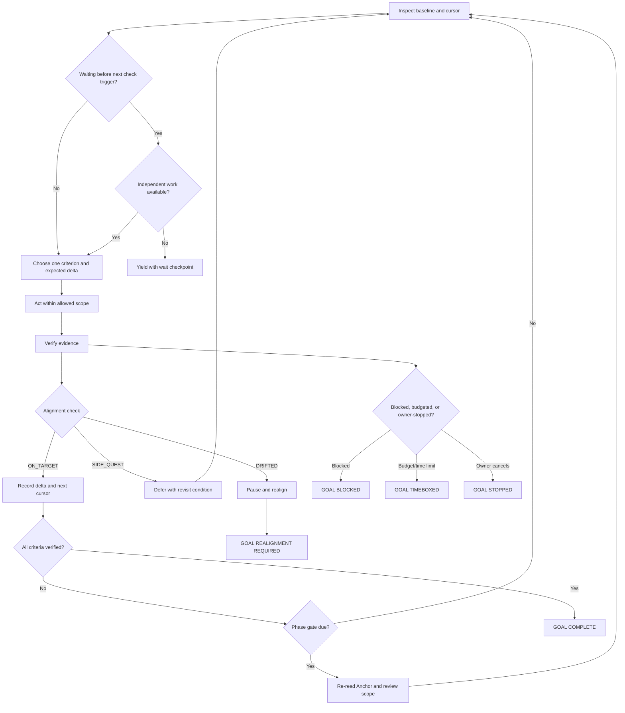

# Loop Preview Reference

Use this format when the user wants to inspect the execution loop before the
final Goal is written. The preview should be concrete enough to review, but it
is not permission to execute the work.

## Preview contract

Show these elements in order:

1. **Provisional outcome:** the current best one-sentence result, with
   assumptions called out.
2. **Starting state:** the baseline, known constraints, and first cursor.
3. **Iteration flow:** what is inspected, selected, executed, verified, and
   recorded in one cycle.
4. **Branches:** what happens after success, a new failure, no progress, a side
   quest, missing authority, a scheduled external wait, or a drift signal.
5. **Progress evidence:** what must change for an iteration to count; which
   checks run during edits or at delivery, when evidence can be reused, and
   which changes trigger a rerun. Include bounds for expensive checks.
6. **Drift gates:** when the Anchor is re-read and what triggers realignment.
7. **Terminal states:** exact complete, blocked, paused, timeboxed, and stopped
   conditions.
8. **Decisions to confirm:** only the choices that could materially change the
   loop, scope, evidence, or terminal rules. For feedback, adoption, pilot,
   launch, or validation work, confirm the evidence threshold, what counts, and
   the feedback window; for pending dependencies, include the next check
   time/event, deadline/unblock, and independent work or yield branch.

End with a handoff such as: “确认这个循环后，我再生成最终 Goal 指令。” Do not
include a final executable Goal in a preview-only response and do not perform
external mutations.

## Visual shape



Overall time, token, and tool limits apply on every branch. The wait checkpoint
records when the host or user may resume; it does not create a scheduler.

## Preview table

| Point in the loop | Preview question | Required decision |
| --- | --- | --- |
| Start | What state and cursor are authoritative? | Baseline and first work unit |
| Select | Which criterion moves next? | Target criterion and expected delta |
| Act | What is inside the boundary? | Allowed scope and authority |
| Verify | What proves progress, and when must it be checked again? | Focused and phase/delivery checks, pass/fail rule, evidence reuse, rerun triggers, cost bounds |
| Branch | What happens if the result is unexpected? | Retry with a new hypothesis, defer, block, or realign |
| Gate | When is the Anchor re-read? | Cadence, milestone, and high-risk trigger |
| Feedback | How much evidence counts as real feedback? | Threshold, what counts, and feedback window |
| Wait | When can an external dependency be checked again? | Next check time/event, deadline/unblock, independent work or yield |
| End | What makes the work legally stop? | Complete, blocked, paused, timeboxed, stopped |

## Example preview

```markdown
## Loop preview

### Provisional outcome
Produce a tested importer patch that accepts the quoted multiline fixture.
Assumption: the current fixture and test command are authoritative.

### One iteration
Inspect the failing parser path → choose one parsing hypothesis → make one
focused change → run the fixture test → record the diff and result.

### Branches
- Test passes: mark C1 verified and select the next open criterion.
- Test fails with new evidence: revise the hypothesis and try one different
  focused change.
- Same failure twice: stop as `GOAL BLOCKED` with the exact missing evidence.
- Useful unrelated cleanup: mark `SIDE_QUEST` and defer it.
- No criterion moves or scope expands: pause as
  `GOAL REALIGNMENT REQUIRED`.

### Gate and limits
Re-read the Anchor after three iterations and before changing dependencies.
Use at most four hypothesis iterations. Run the existing importer suite once
the parser is stable; after a further parser change, refresh affected regression
evidence. Report-only edits do not invalidate unrelated passing parser checks.
Use the repository's command timeout for expensive checks; report any unverified
criterion if it expires.

### Confirm before drafting
Please confirm the retry threshold and whether dependency changes are allowed;
then the final Goal can be generated.
```
